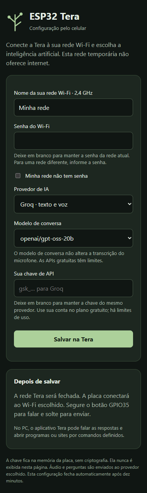

# ESP32 Tera — Alpha 1.0

Assistente de IA para a **TTGO T-Display original**, com entrada por microfone, respostas na tela e integração opcional com Windows. Identidade minimalista em cinza e verde, com uma árvore que ganha folhas quando chega uma resposta.

## Recursos da Alpha 1.0

- **IA:** GPT-OSS 120B pela Groq como padrão; troca para 20B na configuração. OpenRouter oferece alternativa de texto com modelos gratuitos. Cada usuário usa sua chave; os planos gratuitos têm cotas.
- **Entrada de voz:** microfone analógico amplificado no GPIO32, botão GPIO35 para falar e soltar para enviar, até dez segundos. Transcrição Groq na nuvem.
- **Voz feminina no PC:** Dora/Kokoro em português brasileiro, gerada localmente. Faber/Piper e vozes Windows permanecem alternativas. Não há alto-falante na placa.
- **Comandos naturais definidos:** “pode abrir a calculadora?”, “Tera, abre o Bloco de notas, por favor”. Alvos permitidos: calculadora, Bloco de notas, explorador, navegador, GitHub e YouTube. Frases ambíguas pedem esclarecimento. A interpretação desses comandos é local; respostas da IA não executam código.
- **Contexto:** Tera conhece o dispositivo e o estado da integração PC; uma troca anterior fica na RAM. Não tem memória permanente.
- **Configuração:** USB ou rede Wi-Fi temporária acessada pelo celular. Modelos são salvos sem reinstalar o firmware. Chaves nunca aparecem no portal ou nos downloads.
- **Recuperação:** reconexão USB, renovação de sessão após reinício, deduplicação de ações e watchdog de 120 segundos.

## Instalação e uso

Leia o [guia completo em português e inglês](docs/INSTALACAO-ALPHA.md). Requisitos: TTGO original, USB de dados, Wi-Fi 2,4 GHz e Windows com Python 3.12 para a integração PC.

No pacote local: `instalar.cmd` instala dependências e voz; `gravar-firmware.cmd` grava a placa; `configurar.cmd` abre o aplicativo. Não é um executável independente. Os modelos de voz são baixados separadamente. A gravação preserva a NVS.

Pelo celular, segure GPIO0 por aproximadamente dois segundos, conecte à rede TERA usando a senha na tela e abra http://192.168.4.1. Não segure GPIO0 durante reset. Depois de salvar, a placa fecha o portal e conecta ao Wi-Fi configurado.

Segure GPIO35 para falar e solte para enviar. GPIO0 avança as páginas da resposta. Mantenha o aplicativo Windows aberto para áudio e comandos no PC. O X minimiza; **Encerrar assistente** fecha.



Captura da página real com dados de exemplo, navegador de 390 px e servidor simulado; teste HTTP/DNS na placa foi executado separadamente.

## Testes e limites

[Resultados da Alpha 1.0](docs/RESULTADOS-ALPHA-1.0.md). A versão foi testada com a placa física, consultas autenticadas à Groq e reprodução local. O relatório distingue testes automáticos, gravações anteriores e funções ainda não verificadas em outro computador/celular.

IA e transcrição exigem internet. O plano gratuito não é ilimitado. OpenRouter não oferece entrada de voz nesta alpha. O teclado opcional e o alto-falante físico ainda não foram implementados. Requisições HTTPS têm timeout e são bloqueantes, sem streaming. A última troca é limitada a 512 bytes de pergunta e 1024 bytes de resposta.

Chaves ficam na NVS sem criptografia; não distribua dumps da flash. Áudio é enviado à Groq, perguntas ao provedor selecionado. Síntese de voz no PC usa WAV temporário apagado após reprodução. [Hardware e montagem](docs/HARDWARE.md) · [Componentes e licenças](docs/THIRD-PARTY.md).

## Desenvolvimento

```text
pio run -e ttgo_t_display
python tools/test_pc_bridge.py
python tools/test_device.py
python tools/test_alpha_device.py
python tools/test_pc_recovery.py
python tools/package_alpha.py
```

Os testes físicos usam COM3 por padrão e consomem chamadas da API. O teste de recuperação usa uma gravação sintetizada local, fora do Git. O pacote é criado em `dist`, com manifesto SHA-256 e apenas arquivos explicitamente selecionados. Nada é publicado pelo script.

## English

**ESP32 Tera Alpha 1.0** is an AI assistant for the original TTGO T-Display. Hold GPIO35 to record amplified analog microphone input on GPIO32, release to submit up to ten seconds, and read the response on the display. Short-press GPIO0 to advance pages. AI and transcription require internet and a personal API key.

Groq GPT-OSS 120B is the default chat model; 20B is selectable without reflashing. OpenRouter supports text-only free models. Free accounts have usage limits. The system context identifies Tera, its hardware and current PC capabilities. One bounded previous exchange stays in RAM.

The optional Windows companion produces offline Brazilian Portuguese female Dora speech using Kokoro. It opens an allowlisted set of applications/sites from supported Portuguese request variants, including polite phrases. Negative requests are not executed; ambiguous targets request clarification. AI responses never become executable shell commands. PC audio/actions need the companion running. Closing its window minimizes it; the explicit Quit button stops it.

Setup is available over USB and a temporary password-protected Wi-Fi network for phone configuration. Hold GPIO0 for about two seconds while running, connect using the displayed password and visit http://192.168.4.1. Do not hold GPIO0 during reset. The portal closes after saving or ten minutes.

The local release ZIP includes firmware with integrity hashes, source and Windows setup scripts. It requires Python 3.12 and downloads voice models separately. API keys and existing configuration are not included. Read the [installation guide](docs/INSTALACAO-ALPHA.md) and [test results](docs/RESULTADOS-ALPHA-1.0.md). Physical keyboard/speaker are not implemented. Credentials remain in unencrypted NVS; never publish device flash dumps. Cloud providers receive audio/text, and HTTPS requests are blocking with timeouts. USB reconnection, session recovery and a main-task watchdog improve fault recovery.

No website or public release has been created for this local preparation.
